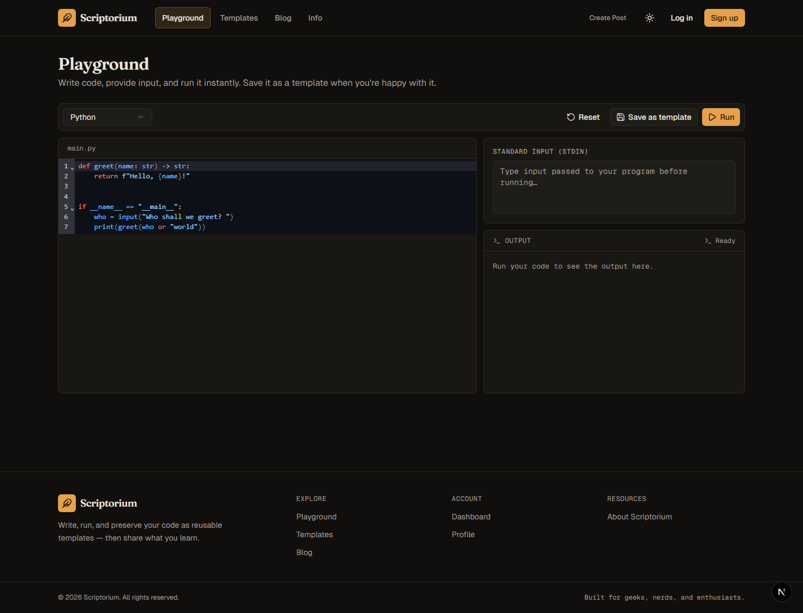

# Scriptorium

**Write code in the browser, run it in an isolated container, and keep useful snippets as shareable templates.**

Scriptorium is a portfolio project exploring the workflow around small code experiments: start in an editor, test an idea with standard input, then save, search, fork, and share the result. It also includes a community area for technical posts and comments.

Credits to Professor [Kianoosh Abbasi](https://www.cs.toronto.edu/~kianoosh/) at UofT for the project idea. This is one of his assignment projects for CSC309.

## See it in action



From **Playground**, edit the starter code and select **Run**. The default Python sample prints `Hello, world!` without requiring input or an account. When you choose **Save as template**, sign in or create a free account; your code is restored when you return, and the newly created template opens automatically.

### Try the complete flow

1. Start the app using the local setup below, then open `/playground` or choose **Playground** from the navigation.
2. Click **Run** to see `Hello, world!` in the output panel. You can edit the sample first; standard input is optional.
3. Choose **Save as template**, enter a title, then create an account or log in if prompted. Your code and input are restored when you return.
4. Create the template. Scriptorium opens its page, where you can run it again; the template is also listed in the public library.

## What it does

- **In-browser code editor** with language-aware editing for Python, JavaScript, C, C++, and Java.
- **Code execution** in Docker containers with networking disabled, resource limits, read-only mounts/root filesystem, and bounded execution time/output.
- **Reusable templates** with descriptions, tags, search, saved collections, and attribution when forking another template.
- **Community features** including blog posts, comments, votes, reports, and administrator moderation.
- **Accounts and profiles** with authenticated actions and protected admin endpoints.

## Tech stack

- Next.js App Router, React, and TypeScript
- Prisma ORM with SQLite for straightforward local development
- Docker for isolated code execution
- CodeMirror for the editor
- SWR for client-side data fetching and cache revalidation
- Radix UI primitives and Tailwind CSS for accessible, consistent UI

## Run locally

### Prerequisites

- Node.js 22.18 or newer and npm
- Docker Desktop (or a Docker Engine) running locally; the runner automatically pulls a language image the first time that language is used, so Docker and an internet connection are needed for that first run

### Install and configure

```powershell
npm ci
cp .env.example .env
```

On Windows PowerShell, use `Copy-Item .env.example .env` if `cp` is unavailable.

Set unique, random values for `JWT_ACCESS_SECRET` and `JWT_REFRESH_SECRET` in
`.env` before using authentication. For example, generate each value with:

```powershell
node -e "console.log(require('crypto').randomBytes(32).toString('hex'))"
```

The example environment file points SQLite at `prisma/dev.db`. The database
file is created locally by the migrations and is not included in Git. Keep
`.env` private; it is ignored by Git.

### Environment variables

| Variable | Required | Purpose |
| --- | --- | --- |
| `DATABASE_URL` | Yes | Prisma database URL. The example uses a local SQLite file. |
| `JWT_ACCESS_SECRET` | Yes | Signs access tokens. Use a unique random value. |
| `JWT_REFRESH_SECRET` | Yes | Signs refresh tokens; must differ from the access secret. |
| `NEXT_PUBLIC_API_URL` | No | API origin for a separate API host. Empty by default, so browser requests use the app's origin. |
| `SALT_ROUNDS` | No | bcrypt work factor; defaults to `10`. |
| `ACCESS_TOKEN_EXPIRY` | No | Access-token lifetime in hours; defaults to `10`. |
| `REFRESH_TOKEN_EXPIRY` | No | Refresh-token lifetime in weeks; defaults to `4`. |
| `EXECUTION_TIMELIMIT_MS` | No | Maximum execution time; defaults to `10000` ms. |
| `MEMORY_LIMIT_MB` | No | Container memory limit; defaults to `128` MB. |
| `CPU_LIMIT` | No | Container CPU quota; defaults to `0.5` CPU. |
| `EXECUTION_PIDS_LIMIT` | No | Maximum processes per execution container; defaults to `64`. |
| `MAX_CODE_SIZE_KB` | No | Maximum submitted code size; defaults to `64` KB. |
| `MAX_STDIN_SIZE_KB` | No | Maximum submitted stdin size; defaults to `64` KB. |
| `MAX_OUTPUT_SIZE_KB` | No | Maximum captured stdout size; defaults to `64` KB. |

The server fails during initialization if either JWT secret is missing or if
the two secrets are identical. Configure both in local `.env` and in any
deployment environment; never use the example placeholders as production
secrets. `NEXT_PUBLIC_API_URL` should be an HTTPS origin when using a separate
API host. Cross-origin cookie authentication requires corresponding CORS and
cookie configuration; same-origin requests are the supported default.

### Initialize the database and start

```powershell
npx prisma migrate dev
npx prisma generate
npm run dev
```

Open [http://localhost:3000](http://localhost:3000). You can try the playground
without an account; create an account to save templates and use other
authenticated features. Docker must be available to the Next.js server for the
execution endpoint. The runner automatically pulls each language image when it
is first needed.

### Enable local moderation

To try the moderation page, first register a user through the app, then promote
that account from the project directory:

```powershell
npm run db:promote-admin -- your-username
```

Sign out and back in so the new admin role is reflected in the session. This
command updates only the local database and does not add an unauthenticated
admin-creation endpoint.

Useful project scripts:

| Command | Purpose |
| --- | --- |
| `npm run dev` | Start the local development server |
| `npm run build` | Build the production application |
| `npm run start` | Serve a production build |
| `npm run lint` | Run ESLint |
| `npm test -- --runInBand` | Run the focused Jest test suite |

## Design decisions

### Keep the first experiment frictionless

Writing and running code does not require an account. Authentication is needed
for ownership-based features such as saving templates, voting, or moderation.
This lets a visitor understand the main product idea before registering.

### Use Docker as an execution boundary

Submitted code runs in a separate container rather than in the Next.js process.
The runner disables container networking and configures CPU, memory, time, and
output limits; submitted files are mounted read-only and the container root
filesystem is read-only. These controls make the execution path safer to
operate, but are not a substitute for a dedicated, hardened production
sandbox.

### Model reusable work explicitly

Templates, tags, authorship, saved templates, and parent/fork relationships are
represented in the Prisma schema. Keeping these relationships in the data model
makes browsing and attribution part of the product rather than conventions
encoded only in UI state.

### Choose pragmatic infrastructure for a portfolio

SQLite keeps local setup lightweight and makes the project easy to explore.
Docker provides a clear boundary for running untrusted code. Both choices
prioritize a reproducible demonstration over claims of production scale; a
public deployment would need additional operational hardening and a deployment
environment designed for isolated workloads.

## Project layout

```text
app/                 Next.js pages and API route handlers
components/          Shared UI and feature components
contexts/            Theme and user-session providers
lib/                 Client-side hooks and shared application logic
prisma/              Data model and database migrations
utils/               API, authentication, validation, and data helpers
```

## Current scope and limitations

This is a portfolio application, not a hosted execution service. Code execution
requires Docker access from the server and pulls its configured language
images. Focused tests cover authentication and admin access, template create
and update behavior, and execution input limits; this is not exhaustive
integration coverage. The SQLite setup is intended for local development and
demos, not high-concurrency production use.

### Hosting on Vercel

Vercel deploys Next.js applications through its platform build system; it does
not run this project's Docker-based code runner or deploy a custom application
Docker image. The execution API therefore will not work on Vercel as currently
implemented. To publish a Vercel demo, the runner must be disabled or moved to
a separate Docker-capable service. The current SQLite database is also local
file storage, so a persistent public deployment needs a hosted database and a
compatible Prisma provider/configuration. Do not expose the execution endpoint
publicly until the runner is hosted with appropriate isolation and abuse
controls.

## Contributing

For a local change, install dependencies, configure `.env`, apply migrations,
and run the development server as described above. Before opening a pull
request, run `npm run lint` and `npm run build`. Keep database changes in
Prisma migrations and avoid committing `.env`, generated database files, or
other local state.
