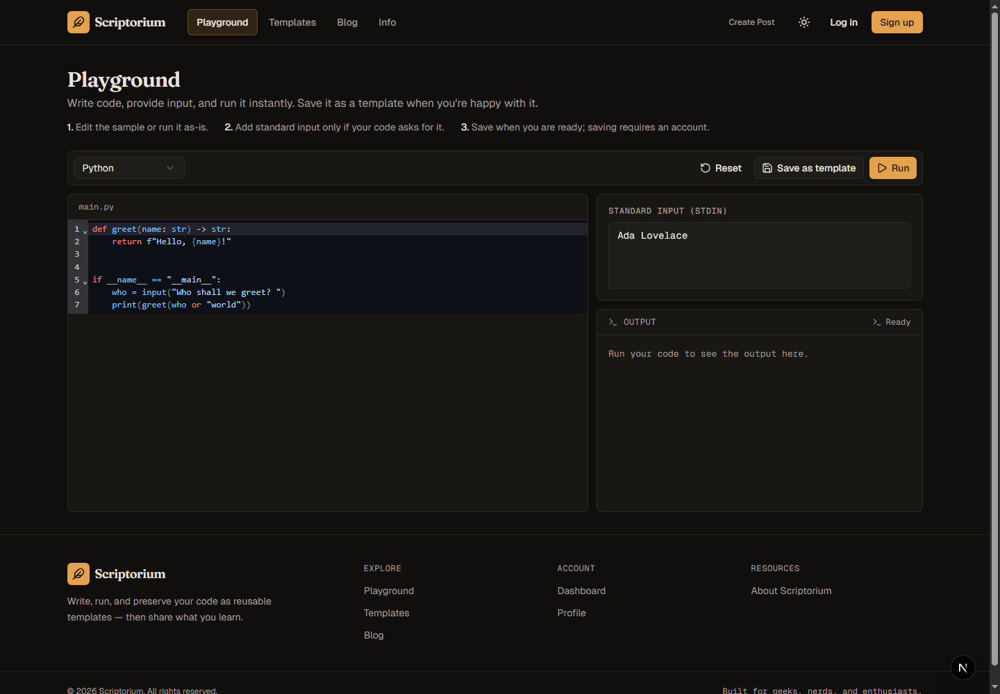
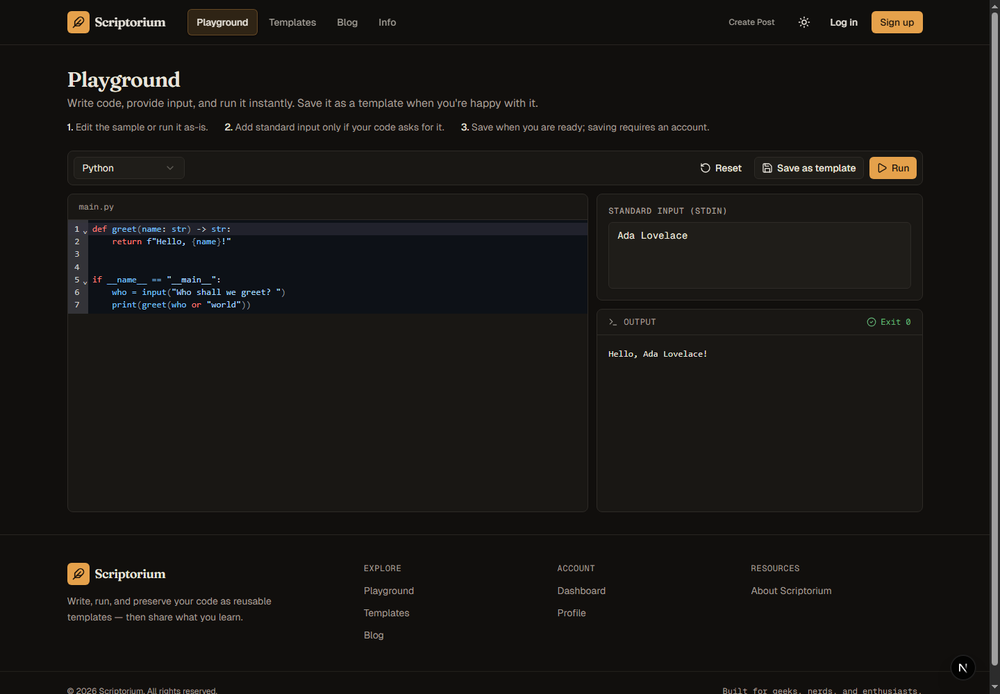
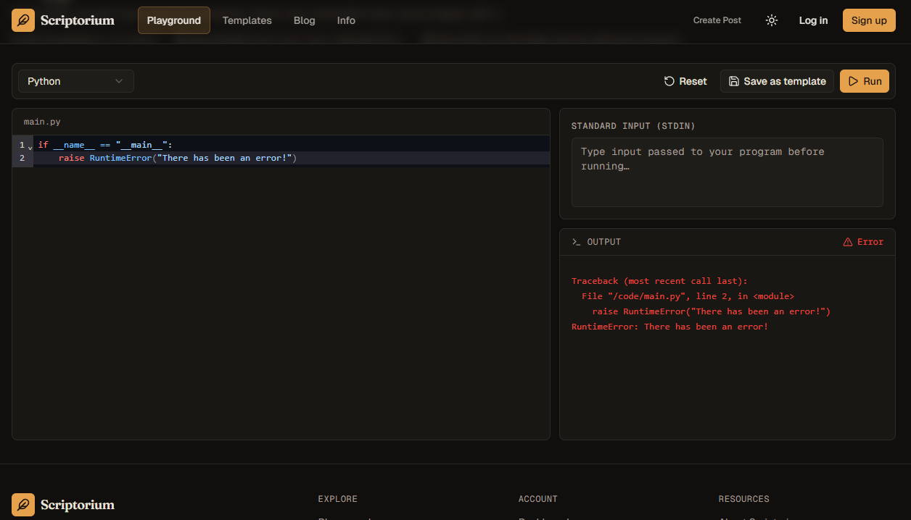
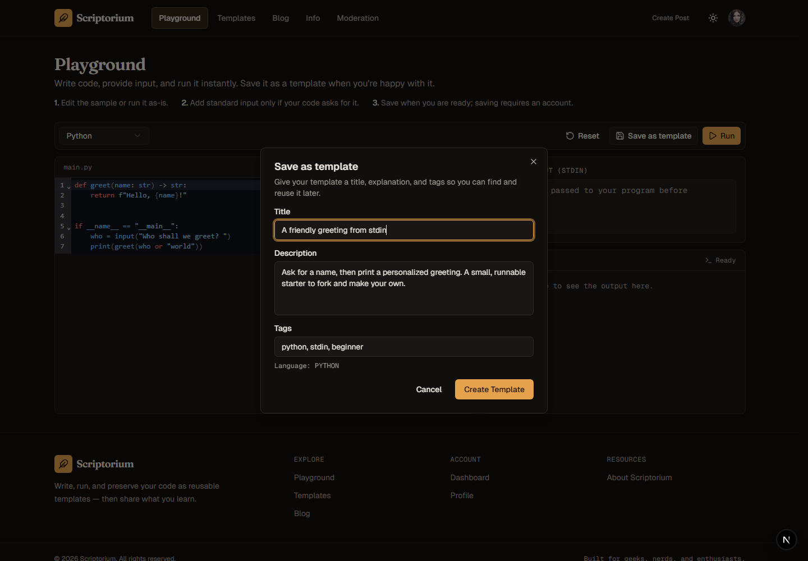
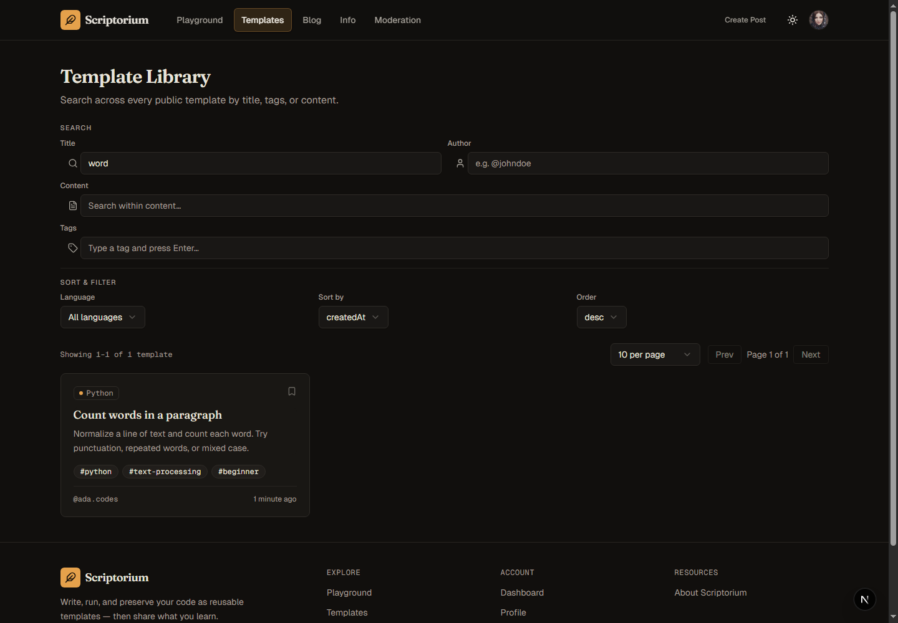
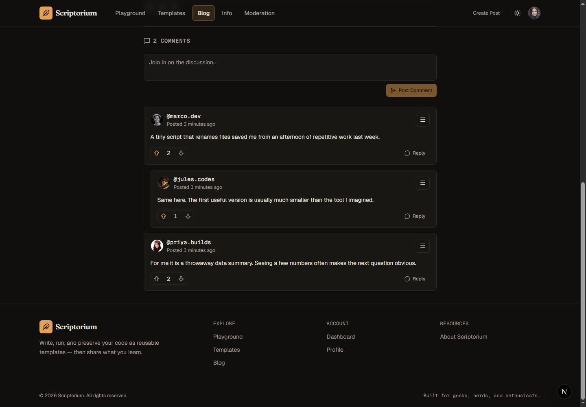

# Scriptorium

**Write code in the browser, run it in an isolated container, and keep useful snippets as shareable templates.**

> "Scriptorium is an innovative online platform where you can write, execute, and share code in multiple programming languages. Inspired by the ancient concept of a scriptorium, a place where manuscripts were crafted and preserved, Scriptorium modernizes this idea for the digital age. It offers a secure environment for geeks, nerds, and coding enthusiasts to experiment, refine, and save their work as reusable templates. Whether you’re testing a quick snippet or building a reusable code example, Scriptorium is what you need to bring your ideas to life."

Scriptorium is a full stack portfolio project for exploring the entire life-cycle of software/web development and learning the associated modern tech stacks (Next.js, Prisma, REST, React, TailwindCSS, and Docker). Deliverables for program behaviour were provided using user stories. The front-end, back-end, and database were designed and written by me from there.

Scriptorium is intended to be a leetcode-like clone. Features include
- **In-browser code editor** with language-aware editing for Python, JavaScript, C, C++, and Java.
- **Code execution** in Docker containers with networking disabled, resource limits, read-only mounts/root filesystem, and bounded execution time/output.
- **Reusable templates** with descriptions, tags, search, saved collections, and attribution when forking another template.
- **Community features** including blog posts, comments, votes, reports, and administrator moderation.
- **Accounts and profiles** with authenticated actions and protected admin endpoints.

Credits to Professor [Kianoosh Abbasi](https://www.cs.toronto.edu/~kianoosh/) at UofT for the project. This is one of his assignment projects for CSC309.


## Tech stack

- Next.js App Router, React, and TypeScript
- Prisma ORM with SQLite for straightforward local development
- Docker for isolated code execution
- CodeMirror for the editor
- SWR for client-side data fetching and cache revalidation
- Radix UI primitives and Tailwind CSS for accessible, consistent UI


## See it in action

### Playground: code, execution, input, output, and errors


From **Playground**, edit the starter code and select **Run**. When you choose **Save as template**, sign in or create a free account; your code is restored when you return, and the newly created template opens automatically.


<table>
  <tr>
    <td width="50%"><strong>Before running</strong><br></td>
    <td width="50%"><strong>Successful execution</strong><br></td>
  </tr>
</table>




### Save and discover templates

<table>
  <tr>
    <td width="50%"><strong>Creating a template</strong><br></td>
    <td width="50%"><strong>Searching the library</strong><br></td>
  </tr>
</table>

### Join the discussion



## Run locally

### Prerequisites

- Node.js 22.18 or newer and npm
- Docker Desktop (or a Docker Engine) running locally; the runner automatically pulls a language image the first time that language is used, so Docker and an internet connection are needed for that first run

### 1. Install and configure

```powershell
npm ci
cp .env.example .env
```

On Windows PowerShell, use `Copy-Item .env.example .env` if `cp` is unavailable.

#### 1.1. Environment variables

| Variable | Required | Purpose |
| --- | --- | --- |
| `DATABASE_URL` | Yes | Prisma database URL. The example uses a local SQLite file. |
| `JWT_ACCESS_SECRET` | Yes | Signs access tokens. Use a unique random value. |
| `JWT_REFRESH_SECRET` | Yes | Signs refresh tokens. |
| `NEXT_PUBLIC_API_URL` | No | API origin for a separate API host. Empty by default, so browser requests use the app's origin. |
| `SALT_ROUNDS` | No | bcrypt work factor; defaults to `10`. |
| `ACCESS_TOKEN_EXPIRY` | No | Access-token lifetime in hours; defaults to `10`. |
| `REFRESH_TOKEN_EXPIRY` | No | Refresh-token lifetime in weeks; defaults to `4`. |
| `EXECUTION_TIMELIMIT_MS` | No | Maximum execution time; defaults to `10000` ms. |
| `MEMORY_LIMIT_MB` | No | Container memory limit; defaults to `128` MB. |
| `CPU_LIMIT` | No | Container CPU quota; defaults to `0.5` CPU. |
| `EXECUTION_PIDS_LIMIT` | No | Maximum processes per execution container; defaults to `64`. |
| `MAX_CODE_SIZE_KB` | No | Maximum submitted code size; defaults to `64` KB. |
| `MAX_STDIN_SIZE_KB` | No | Maximum submitted stdin size; defaults to `64` KB. |
| `MAX_OUTPUT_SIZE_KB` | No | Maximum captured stdout size; defaults to `64` KB. |

### 2. Initialize the database and start

```powershell
npx prisma migrate dev
npx prisma generate
npm run dev
```

Open [http://localhost:3000](http://localhost:3000). You can try the playground
without an account; create an account to save templates and use other
authenticated features. Docker must be available to the Next.js server for the
execution endpoint. The runner automatically pulls each language image when it
is first needed.


#### 2.1. Seed sample community content

To replace the local database's users and sample content with the curated demo
community, run:

```powershell
npm run db:seed:demo
```

This destructive, repeatable seed replaces all users, templates, posts,
comments, tags, reports, and votes in the configured database. It creates five
sample users, each with a random-avatar image URL, and gives every account the
demo-only password `Scriptorium-Demo1!`. The `ada.codes` account has the admin
role. Do not use these credentials or run this seed against a database
containing data you need to keep.

#### 2.2 Enable local moderation

To try the moderation page, first register a user through the app, then promote
that account from the project directory:

```powershell
npm run db:promote-admin -- your-username
```

Sign out and back in so the new admin role is reflected in the session. This
command updates only the local database and does not add an unauthenticated
admin-creation endpoint.

## Project layout

```text
app/                 Next.js pages and API route handlers
components/          Shared UI and feature components
contexts/            Theme and user-session providers
lib/                 Client-side hooks and shared application logic
prisma/              Data model and database migrations
utils/               API, authentication, validation, and data helpers
```
